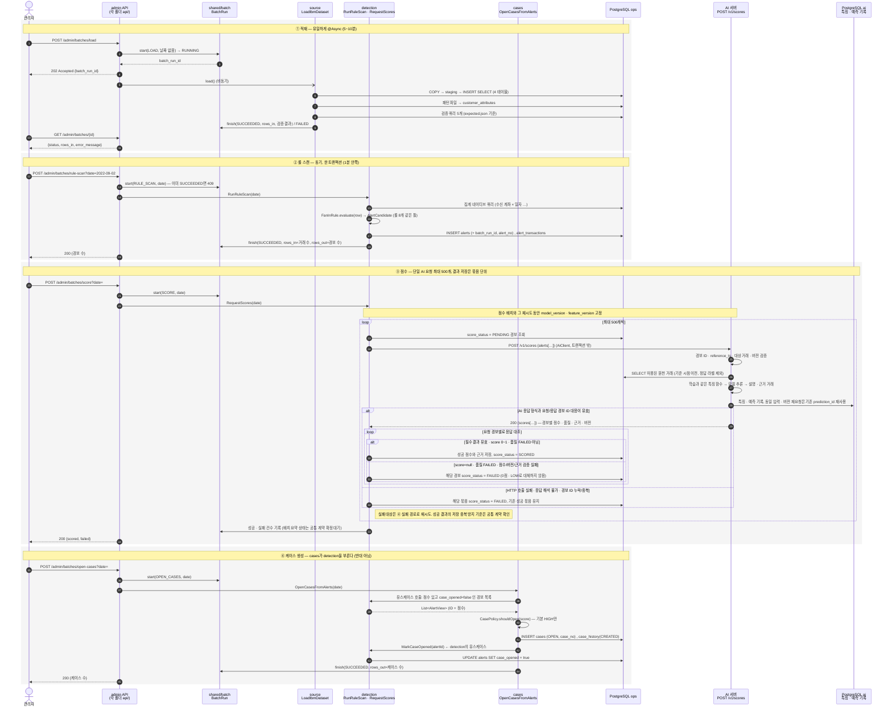

# ① 배치 체인 — 적재 → 룰 스캔 → 점수 → 케이스 생성

관리자가 버튼 네 번을 누르면 경보가 케이스가 된다. 네 배치는 전부 **`shared/batch`의 `BatchRun`** 에 기록되고(10/27 안건 14), 같은 날짜·유형을 두 번 돌리면 `409 BATCH_ALREADY_DONE`.

폴더 의존 방향 `source ← detection ← cases ← str` 그대로다. 케이스 배치가 detection을 부르지, detection이 cases를 부르지 않는다(지윤 문서 2절과 같음).

**ML 연동 보완 (2026-10-22, 준영)**: 아래 ③은 점수 파이프라인의 구현 기준이다. 성공 후 재실행 차단, 재시도 `batch_type`, 배치 요약 상태·건수는 공통 계약 확정 대상이다. 위의 중복 실행 설명만으로 점수 재시도까지 금지하지 않는다. [README의 공통 확인 항목](README.md#ml-연동에서-공통-확인이-필요한-항목)을 함께 본다.

## 읽을 때 같이 볼 것

| 질문 | 답 (그림 번호) |
|---|---|
| `batch_runs`는 누구 소속? (준혁) | `shared/batch`. 네 배치가 전부 같은 `BatchRun`을 쓴다 — ①~④의 `BR` 줄 |
| 적재만 `@Async`인가? (준혁) | 적재는 기존 설계대로 `202 + GET /batches/{id}` 폴링. 점수는 동기이며 단일 요청과 전체 배치 시간을 구분해 측정한다. 룰 스캔·케이스의 기존 실행 방식은 유지 |
| 케이스 배치가 detection을 부르는 방향 (지윤) | ④. `cases → detection` 유스케이스 두 개(경보 조회, `MarkCaseOpened`)만 부른다. detection은 cases를 모른다 |
| 점수 실패 묶음은? | ③ 안의 note → [④ 실패 경로](04_failure_paths.md) |
| 날짜 두 번 누르면? | 원문의 409 차단 정책은 공통 확인 대상. 점수 실패 대상 재시도와 새 유효 점수의 후속 케이스 생성을 막지 않는 재실행 기준을 별도로 확정 |

## ML 연동에서 확인할 것

- `500`은 단일 `/v1/scores` 요청의 상한이다. 전체 날짜의 점수 배치는 여러 요청을 포함하므로 전체 처리시간과 단일 요청 시간을 따로 측정한다.
- 입력은 경보 ID·대상 계좌·시간창·`reference_ts`·대상 거래 ID를 유지한다. 특징은 각 경보의 기준 시점 이전 관측으로 계산하고 학습과 같은 함수를 사용한다.
- 서비스 근거 거래는 서비스 HI-Small의 ID로 조회할 수 있어야 한다. 학습용 LI·SAML의 거래 ID를 서비스 응답에 넣지 않는다. 근거 범위는 확정된 경보 입력 계약을 따른다.
- 응답 형식과 요청/응답 ID의 대응을 먼저 검사한다. 경보 ID 누락·중복·알 수 없는 ID로 응답을 신뢰할 수 없으면 해당 묶음을 저장하지 않고 실패 처리한다. 대응이 유효한 응답은 경보별 점수·모델/특징 버전·품질·근거를 검사한다.
- 같은 경보·같은 입력·같은 모델/특징 버전의 재요청은 AI에 저장된 `prediction_id`와 결과를 재사용한다. HTTP 요청 시도 로그는 예측 결과와 구분해 남긴다.
- AI는 `ops.batch_runs`를 읽거나 수정하지 않는다. 허용된 원천 테이블을 조회하고 `ai` 스키마에 특징·예측을 기록한다. 공통 배치 관리와 케이스 생성은 백엔드 담당 영역이다.
