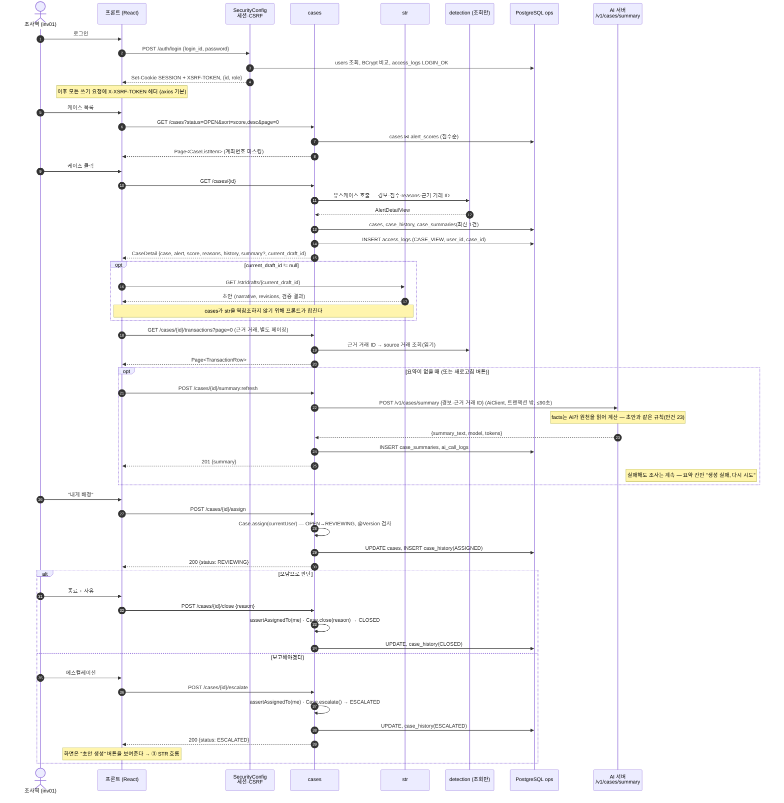

# ② 조사 — 로그인 → 목록 → 상세(+AI 요약) → 배정 → 에스컬레이션

조사역 한 명이 케이스 하나를 다루는 흐름. **cases 폴더는 str 폴더를 모른다**(의존 방향 `cases ← str`). 그래서 "현재 초안"은 케이스 상세 응답에 넣지 않고 **프론트가 따로 한 번 더 부른다**(지윤 문서 2절 "합칠 위치" 질문의 답).

## 읽을 때 같이 볼 것

| 질문 | 답 |
|---|---|
| 상세 응답에 현재 초안을 어디서 합치나? (지윤) | 합치지 않는다. `CaseDetail`에는 `current_draft_id`만 있고, 프론트가 `GET /str/drafts/{id}`를 한 번 더 부른다. 호출 2번이 폴더 경계 지키는 값 |
| 남의 케이스를 열람하면? | 허용. 대신 `access_logs`에 남는다. **수정**(배정·종료·에스컬레이션·메모)만 담당자 제한 → `NotAssigneeException` 403 |
| 메모는 어디에? | 10/27 안건 16 — 기본안은 `case_history` NOTE 행 append |
| 요약 AI가 죽어 있으면? | 조사는 계속. 요약 칸만 실패 표시. [④ 실패 경로](04_failure_paths.md) |
