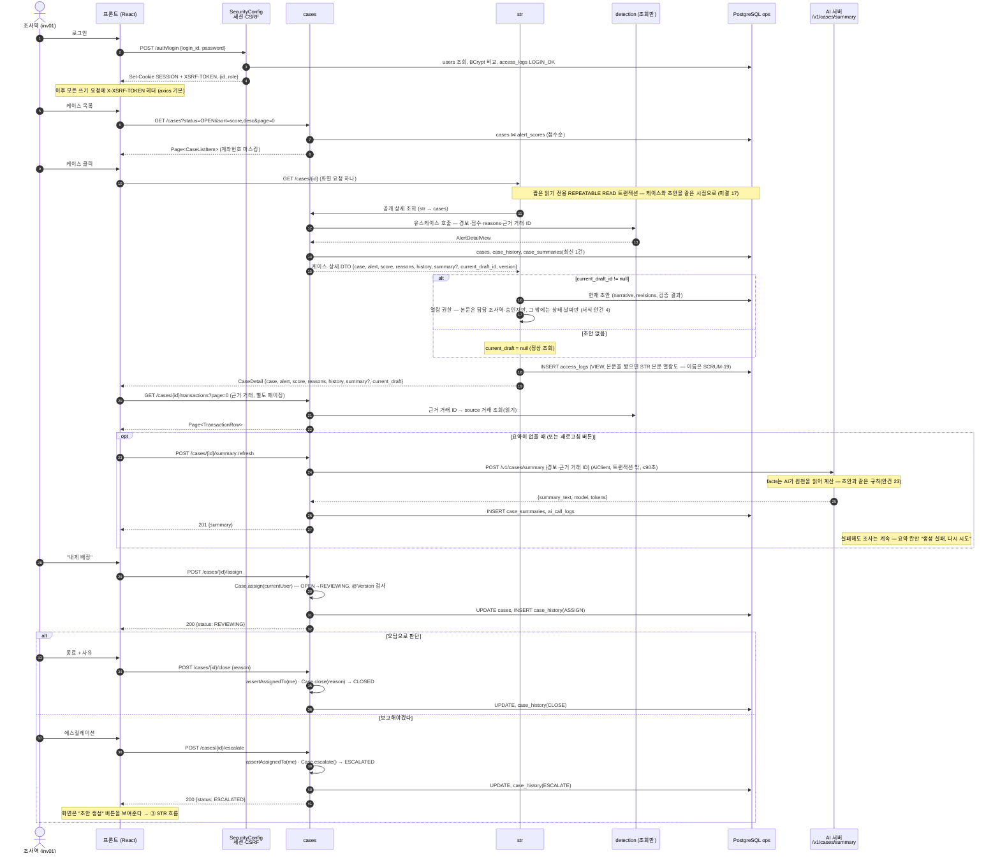

# ② 조사 — 로그인 → 목록 → 상세(+AI 요약) → 배정 → 에스컬레이션

조사역 한 명이 케이스 하나를 다루는 흐름. **cases 폴더는 str 폴더를 모른다**(의존 방향 `cases ← str`). 그래서 "케이스 상세 + 현재 초안"은 **str 쪽 조회 유스케이스가 cases 공개 상세 조회를 불러 조합**하고(str → cases 방향만), 화면 요청은 하나다(미결 17, 10/30).

## 읽을 때 같이 볼 것

| 질문 | 답 |
|---|---|
| 상세 응답에 현재 초안을 어디서 합치나? (지윤) | **str 쪽 조회 유스케이스**가 cases 공개 상세 조회를 불러 조합한다. CASES는 초안 참조 ID·버전과 케이스 정보를 DTO로 주고 str을 역호출하지 않는다. 시점은 짧은 읽기 전용 REPEATABLE READ 트랜잭션, 화면 요청은 하나, 초안이 없으면 `current_draft = null` (미결 17, 10/30) |
| 남의 케이스를 열람하면? | 허용. 대신 `access_logs`에 남는다. **수정**(배정·종료·에스컬레이션·메모)만 담당자 제한 → `NotAssigneeException` 403. **예외 — 현재 초안 본문**은 담당 조사역·승인자만, 그 밖에는 상태·날짜만 (서식 안건 4) |
| 메모는 어디에? | `case_history` NOTE 행, 별도 테이블 없음 (미결 8, 10/30) |
| `case_history` action 이름 | 동사형 — `OPEN`·`ASSIGN`·`REASSIGN`·`NOTE`·`ESCALATE`·`CLOSE` (그림의 이전 `ASSIGNED`·`CLOSED`·`ESCALATED`는 옛 표기, 미결 8) |
| 요약 AI가 죽어 있으면? | 조사는 계속. 요약 칸만 실패 표시. [④ 실패 경로](04_failure_paths.md) |
