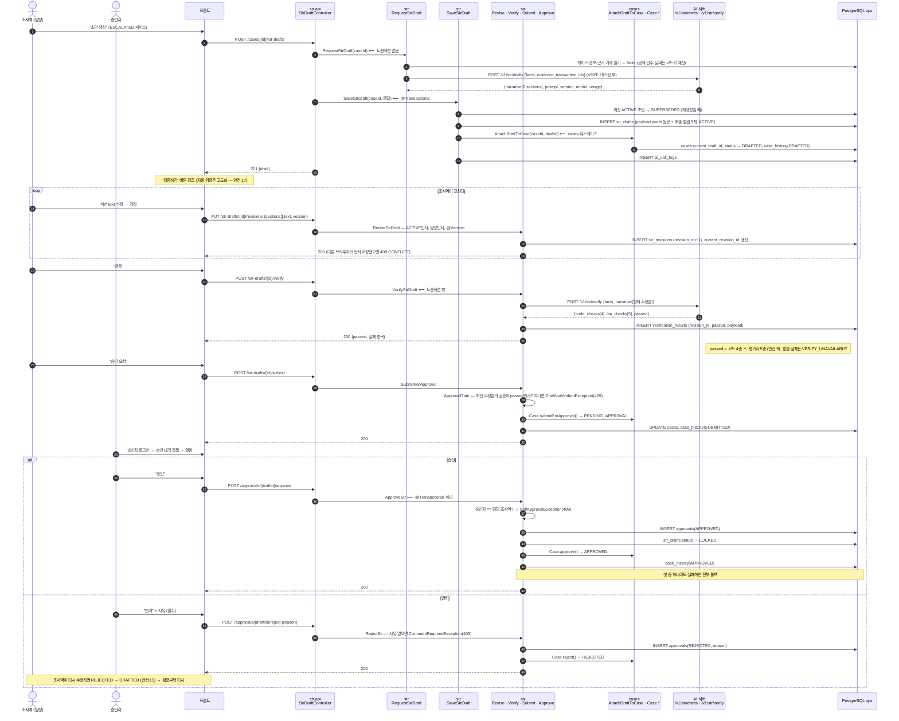

# ③ STR — 에스컬레이션 → 초안 → 수정 → 검증 → 승인

str 폴더의 일. 세 가지 원칙이 그림에 그대로 보인다: **AI 호출은 트랜잭션 밖**(초안 요청·저장이 유스케이스 두 개), **숫자는 코드가 넣고 문장만 LLM이**, **검증 통과한 본문만 승인 요청·승인은 한 트랜잭션**.

## 읽을 때 같이 볼 것

| 질문 | 답 |
|---|---|
| 초안 직후 자동 검증 1회? (채영) | MVP는 안 함. 연속 AI 호출 2번 = 최대 180초. 안건 17. 그림은 "검증하기" 버튼 강조로 표현 |
| 승인 대기 중 수정? (채영) | 불가. PENDING_APPROVAL에서 `ReviseStrDraft`는 409. 고치려면 승인자가 반려 |
| 통과한 본문을 고치면? | 다시 검증해야 승인 요청 가능 — `ApprovalGate`가 "최신 수정본의 검증"을 본다 |
| 승인은 왜 한 트랜잭션? | 케이스 APPROVED·초안 LOCKED·approvals 행이 따로 성공하면 "승인됐는데 수정되는" 상태가 생긴다 |
| 초안 재생성하면? | 이전 초안 SUPERSEDED, 새 초안 ACTIVE, 케이스는 DRAFTED 유지. `AttachDraftToCase`가 두 번째 호출 |
