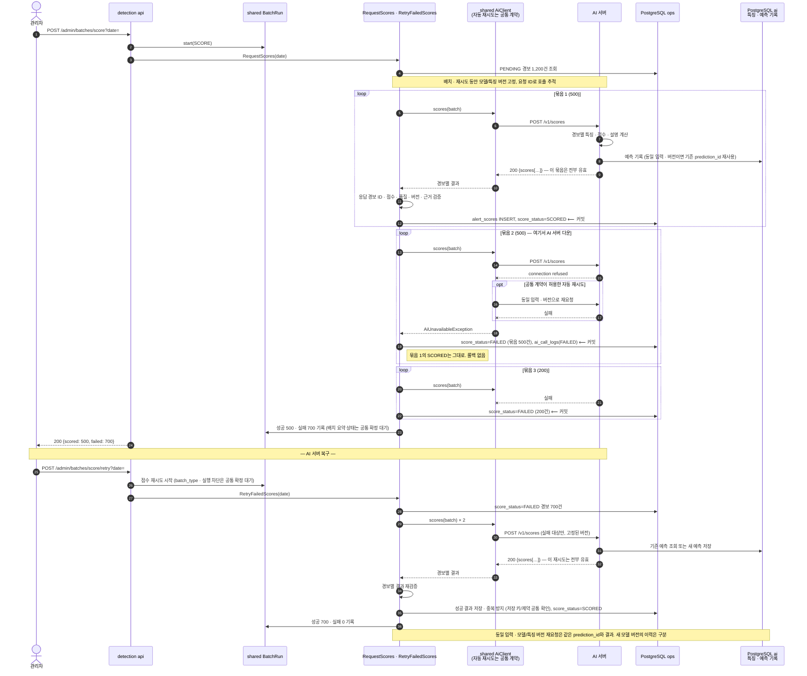
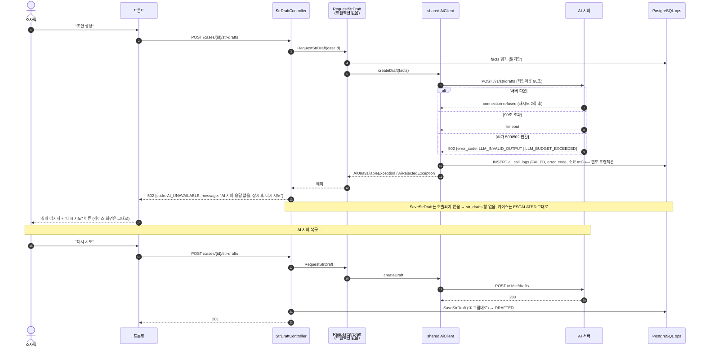

# ④ 실패 경로 — AI 서버가 죽어 있을 때

두 장면. 공통 원칙: **AI 호출은 트랜잭션 밖이라 실패해도 DB가 반쯤 바뀐 상태가 없다**, **실패는 `ai_call_logs`와 상태 컬럼에 남고, 사람이 다시 누른다**. 시나리오 9(점수)와 7(초안)이 이 그림 그대로다.

## 4-1. 점수 배치 실패 → 재시도 (시나리오 9, 준혁)

점수·품질·예측 기록은 준영, 배치 실행과 운영 상태 저장은 준혁 담당이다. 아래는 ML 연동 보완안이다. 자동 재시도 횟수, 재시도 `batch_type`, 배치 요약 상태와 DB 중복 방지 제약은 [공통 확인 항목](README.md#ml-연동에서-공통-확인이-필요한-항목)에서 확정한다.

**됐다 기준(시나리오 9)**: 실패 경보 `FAILED`, 성공 500·실패 700건 기록, 성공 묶음 유지, 복구 후 유효 결과를 받은 실패 대상만 `SCORED`. 같은 입력·버전의 재요청으로 유효 점수가 중복 저장되지 않고, 다른 모델 버전의 점수 이력은 구분한다.

### HTTP 200이어도 경보별로 실패할 수 있다

- `score=null` 또는 `data_quality_status=FAILED`인 경보는 `FAILED`다. 다른 경보의 유효 결과는 보존하고, 실패를 0점·LOW로 바꾸거나 케이스 생성 대상으로 보내지 않는다.
- 요청과 응답의 경보 ID, 점수 범위, 모델/특징 버전, 근거 거래 범위를 대조한다. 누락·중복 ID 등으로 응답을 신뢰할 수 없으면 해당 응답을 저장하지 않고 실패 처리한다.
- AI가 예측 저장을 끝낸 뒤 응답만 유실될 수 있다. 재요청 시 AI는 같은 입력·버전의 저장 결과(`prediction_id`, 점수, 설명, 근거, 생성 시각)를 재사용하고 요청 시도 로그를 별도로 남긴다.
- 품질 실패는 원인이 해소되지 않으면 재시도해도 다시 실패한다. 새 모델로 재평가하는 작업과 단순 통신 재시도를 섞지 않는다.
- ML 쪽에서는 단일 요청 일부 품질 실패, AI 저장 후 응답 유실, 같은 요청 반복, 모델/특징 버전 불일치를 추가 검증한다. 백엔드 저장 중복 방지와 연결하는 기준은 준혁·공통 담당과 확정한다.

## 4-2. 초안 요청 실패 (시나리오 7, 채영)

**됐다 기준(시나리오 7)**: 실패 메시지, 케이스 `ESCALATED` 유지, `ai_call_logs` 실패 행 1개, 서버 켜고 재시도 → 성공.

## 왜 이렇게 되나

| 설계 결정 | 그림에서 보이는 곳 |
|---|---|
| AI 호출은 트랜잭션 밖 (가이드 5절) | 4-2: `RequestStrDraft`가 DB를 안 바꾸니 실패해도 지울 게 없다 |
| 점수는 500개 묶음마다 커밋 (안건 10) | 4-1: 묶음 1 성공분이 묶음 2 실패에 영향 없음 |
| 점수 요청 자동 재시도 | 4-1: 횟수·대상 오류·시간 한도는 공통 `AiClient` 계약으로 확정. 4-2 STR 그림의 원문 횟수는 이번 ML 수정에서 변경하지 않음 |
| 점수 재시도의 저장 중복 방지 | AI는 동일 입력·모델/특징 버전의 `prediction_id`와 결과를 재사용. 백엔드 저장 키/제약은 공통 확인 대상이며 `alert_id` 하나로 모든 모델 버전 이력을 막지 않음 |
| 에러 코드는 백엔드가 매핑 (안건 9) | 4-2: AI 502 → 백엔드 `AI_UNAVAILABLE`, 프론트는 코드로 메시지 |
