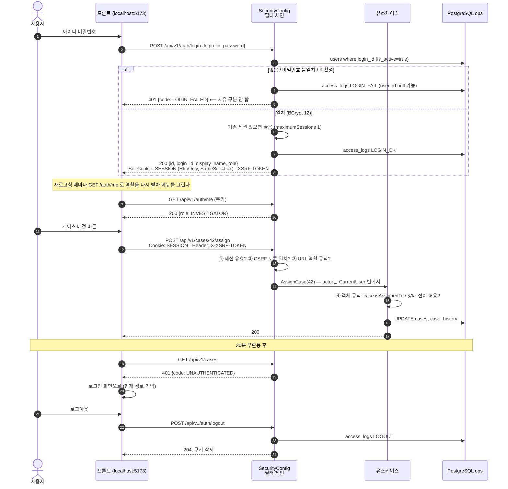
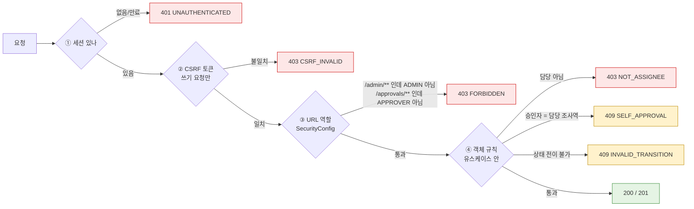
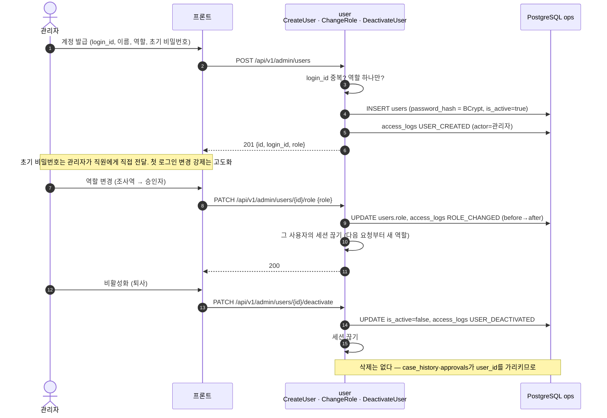

# ⑤ 로그인·권한 — 세션 쿠키, CSRF, 두 겹 차단

사람이 읽는 설명은 「AML 계정·권한 안내」 문서에, 코드 쪽은 백엔드 설계 레퍼런스 9절에. 여기는 그 둘을 잇는 그림.

## 5-1. 로그인 → 보호된 API → 만료

## 5-2. 권한이 막히는 네 지점 (어디서 무슨 코드가 나가나)

프론트 행동 세 줄: **401** → 로그인 화면(경로 기억) · **403** → "권한이 없어요" 토스트, 화면 유지(버튼은 애초에 권한 표대로 숨김) · **409** → 메시지 표시 + 화면 새로고침(남이 먼저 바꾼 경우).

## 5-3. 계정 발급·역할 변경 (관리자, user 기능 W4)

