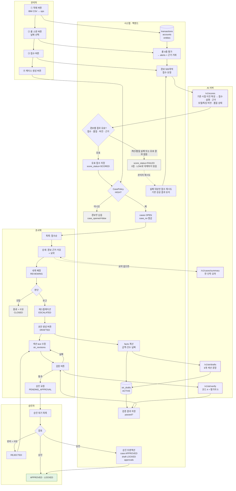

# ⑥ 경보 하나의 일생 — 스윔레인 한 장

발표용·프론트 화면 흐름용. 다섯 줄(관리자 / 시스템 / AI / 조사역 / 승인자)에 경보 하나가 케이스가 되고 보고서가 승인되기까지. 세부는 ①~④ 그림으로.

## ML 연동 보완 (2026-10-22, 준영)

- 계산 실패는 낮은 위험 점수가 아니다. 유효하게 계산된 `SCORED` 결과만 기존 `CasePolicy` 판단으로 보낸다. HIGH의 기준과 케이스 정책은 이 수정에서 변경하지 않는다.
- 실패 대상 재시도는 이미 성공한 경보를 다시 처리하지 않는다. 같은 입력·모델/특징 버전으로 AI에 재요청되면 기존 `prediction_id`와 결과를 재사용한다.
- AI는 서비스 원천에서 특징을 계산하고 `ai` 스키마에 특징·예측을 기록한다. 서비스 근거는 HI-Small 거래 ID를 사용한다. 상세는 [① 배치 체인](01_batch_chain.md), [④ 실패 경로](04_failure_paths.md).
- 재시도 후 새로 유효한 HIGH 경보가 생겼을 때의 추가 케이스 생성과 배치 실행 차단 정책은 공통 확인 대상이다. 이 그림에서 새로운 케이스 생성 정책을 확정하지 않는다.

## 화면과 상태의 대응 (프론트)

| 화면 | 상태 | 보이는 버튼 (역할) |
|---|---|---|
| 케이스 목록 | 전부 | 필터·정렬 (전원) / 배치 버튼 4개 (관리자만) |
| 케이스 상세 | OPEN | 내게 배정 (조사역) / 담당자 지정 (관리자) |
| 케이스 상세 | REVIEWING | 종료 · 에스컬레이션 · 메모 (담당 조사역만) / 담당자 교체 (관리자) |
| 케이스 상세 | ESCALATED | 초안 생성 (담당 조사역) |
| STR 편집 | DRAFTED · REJECTED | 섹션 수정 · 저장 · 검증 · 승인 요청(검증 통과 시만) · 초안 재생성 (담당 조사역) |
| STR 편집 (읽기 전용) | PENDING_APPROVAL | 없음 — 승인자 결정 대기 |
| 승인 | PENDING_APPROVAL | 승인 · 반려(사유 필수) (승인자, 담당 조사역 본인 제외) |
| 케이스 상세 (읽기 전용) | APPROVED · CLOSED | 없음. 이력만 |

케이스 상태 8개의 전이 규칙은 백엔드 설계 가이드 4절. 10/27 안건 11·15에서 종료·반려 전이가 추가될 수 있다.
